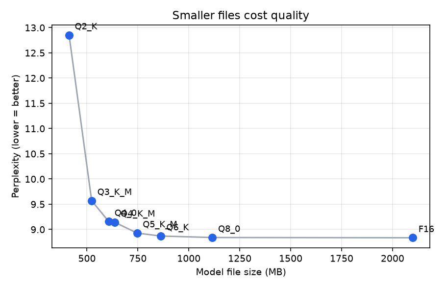
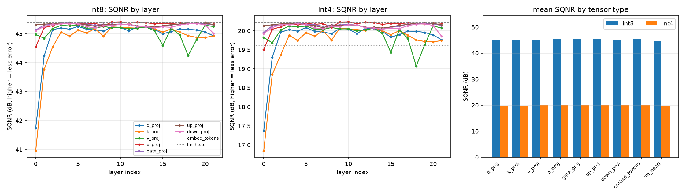

# TinyLlama quantization benchmark

Quantization stores a model's weights with fewer bits. That makes it smaller and
faster, but it can also make it worse. This project measures that trade-off for
TinyLlama 1.1B at seven GGUF quantization levels (Q8_0 to Q2_K) against the 16-bit
original, on a laptop CPU with no GPU, and serves the model behind a small
REST API.

## What gets measured

| Question | Metric | Script |
|---|---|---|
| How much smaller is it? | file size | `step3_quantize_sweep.py` |
| How much RAM does it need? | peak resident memory (fresh process per model) | `step4_benchmark.py` |
| How fast is it? | decode tok/s, prompt tok/s, time to first token (mean ± std) | `step4_benchmark.py` |
| Does it scale with CPU cores? | tok/s vs threads | `step4_benchmark.py --thread-sweep` |
| How much worse are its answers? | **perplexity** on WikiText-2 | `step4b_perplexity.py` |
| How does the API cope with many users? | latency & throughput vs concurrency | `step7_load_test.py` |
| What does my own quantizer lose, layer by layer, and vs Q8_0 / Q4_0? | weight MSE / SQNR, perplexity delta | `step9_custom_quant.py` |

`step6_report.py` merges everything into `results/RESULTS.md` plus charts.

## What I built vs. what I used

Blunt version: **in the main sweep (`step3` to `step8`), llama.cpp does all the real quantization.** `llama-quantize` makes
every GGUF file, `llama-perplexity` scores them, and `llama-cpp-python` runs them. What is mine there is the measurement
harness: the benchmark orchestration, the RAM and speed methodology, the report, the API and the load test.

| Used (not mine) | Built by me |
|---|---|
| llama.cpp quantization formats, `llama-quantize`, `llama-perplexity`, GGUF conversion | `custom_quant.py`: block-wise symmetric absmax int8 / int4 quantizer (block 32, fp16 scale per block) in NumPy, with round-trip, zero-block and odd-size handling |
| `llama-cpp-python` inference, HuggingFace transformers and tokenizer, PyTorch | `custom_quant_eval.py`: runs the HF TinyLlama on my quantized weights (stored compressed, dequantized layer by layer) and scores it with the same window protocol as `llama-perplexity` |
| The `gguf` package (only to read llama.cpp's tensors back) | `step9_custom_quant.py`, `gguf_compare.py`: per-tensor MSE and SQNR for every layer, a direct weight-error comparison with llama.cpp's Q8_0 / Q4_0, and the perplexity comparison |

What my quantizer is not: it is not faster or smaller than llama.cpp's (it is a NumPy research implementation, not an
inference format), and it is not a new method. It is the textbook scheme, built to check that I understand what Q8_0 and Q4_0 do,
and to compare it against the real thing on equal terms.

## Setup (Windows, no compiler needed)

```powershell
step1_setup.bat                 # venv + dependencies (uses a prebuilt llama-cpp-python wheel)
env\Scripts\activate
python step2_download_model.py  # ~2.2 GB raw model
```

Then get llama.cpp, whose tools do the actual conversion and quantization. See
[step3_quantize.md](step3_quantize.md). The quickest route is a prebuilt release, so no CMake is needed.

## Run the whole pipeline

```powershell
python step3_quantize_sweep.py                      # F16 + 6 quantized files
python step4_benchmark.py --thread-sweep 1,2,4      # speed + RAM (~15-30 min)
python step4b_perplexity.py                         # quality (~10-20 min)
python step6_report.py                              # -> results/RESULTS.md + PNG charts
```

My own quantizer (needs `pip install -r requirements-research.txt`; about 25 min total, one model at a time):

```powershell
python step9_custom_quant.py weights   # per-tensor MSE / SQNR + plot (~2 min)
python step9_custom_quant.py gguf      # same error for llama.cpp's Q8_0 / Q4_0 tensors
python step9_custom_quant.py ppl       # fp16, int8, int4, int4_head8 perplexity (~8-12 min each)
python step6_report.py
```

### Side-by-side demo

Ask one question and watch every quantization level answer token by token, with live speed and an automatic correctness check on the preset questions:

```powershell
python step8_compare.py        # opens http://127.0.0.1:8001
```

Models run one at a time: they don't all fit in 8 GB, and running them together would distort the timings. Preset facts and maths are checked by keyword. Preset "write a Python function" questions are checked by running the generated code against test cases, in a separate `python -I` process with a timeout that refuses imports and file access. That denylist is not a real sandbox, so the check is only enabled for the presets. Stop `step5_api.py` first, since both load a model.

### API server and load test

```powershell
python step5_api.py                 # http://127.0.0.1:8000/docs
python step7_load_test.py           # in a second terminal
python step6_report.py              # re-run to add load-test table
```

## Results

Measured on an AMD Ryzen 5 7520U (4 cores), 7.2 GB RAM, no GPU, Windows 11.
4 threads, 3 runs per prompt (mean ± std), perplexity on WikiText-2 (40 × 512-token windows).

| Level | Size MB | Peak RAM MB | Decode tok/s | Speedup | Perplexity | vs F16 |
|---|---|---|---|---|---|---|
| F16 | 2099 | 2066 | 12.5 ± 0.7 | 1.00x | 8.836 | - |
| Q8_0 | 1116 | 1179 | 22.0 ± 1.4 | 1.76x | 8.840 | +0.1% |
| Q6_K | 862 | 940 | 22.1 ± 3.8 | 1.77x | 8.870 | +0.4% |
| Q5_K_M | 746 | 833 | 23.0 ± 1.2 | 1.84x | 8.929 | +1.1% |
| Q4_K_M | 637 | 1187 | 27.6 ± 1.2 | 2.21x | 9.142 | +3.5% |
| Q4_0 | 607 | 1195 | 18.7 ± 1.9 | 1.49x | 9.155 | +3.6% |
| Q3_K_M | 523 | 811 | 26.3 ± 2.6 | 2.11x | 9.571 | +8.3% |
| Q2_K | 412 | 528 | 32.4 ± 1.3 | 2.59x | 12.853 | +45.5% |

Takeaways:
- Q4_K_M is the sweet spot: 70% smaller on disk, 2.2x faster decoding, +3.5% perplexity. Below it quality drops quickly (Q2_K: +45%).
- Decoding is memory-bound: going from 2 to 4 threads adds only about 15% (22.5 to 26.0 tok/s), so the CPU is waiting on RAM.
- Q4_K_M uses more RAM than Q5_K_M because llama.cpp repacks its weights into a faster AVX2 layout (+455 MiB, seen in the verbose load log). Its RAM saving over F16 is 43%, not 70%.
- The speed differences between Q8_0, Q6_K and Q5_K_M are within run-to-run noise.
- Q4_0 (added later, see below) is 30 MB smaller than Q4_K_M with the same perplexity (+3.6% vs +3.5%) but decodes much slower here (18.7 vs 27.6 tok/s, measured twice with the same result). Q4_K_M is better on both quality and speed; only the file size favours Q4_0. Q4_0 was benchmarked in a separate session from the other levels, with other programs open on this 7.2 GB machine, so treat its speed as less comparable than the rest.

**Reading the ±.** The perplexity ± is the standard error over the 40 text windows, and it is almost the same for every level (about ±0.23 to ±0.33) because every level is scored on the same text. The *differences* between levels are paired (same windows for every level), so they are more precise than the error bars suggest. Overlapping error bars do not mean "no difference": Q4_K_M is +3.5% over F16 even though the bars overlap. I measured this for my own evaluator (step 9): for my int4 the change vs F16 is +5.9% with a paired standard error of 0.42% (window level), versus 7.9% if the two runs were treated as independent samples.

**The 5% budget is arbitrary.** The recommendation (smallest level within 5% of F16 perplexity) uses a budget I picked, not a standard. It is configurable (`python step6_report.py --budget 2` or `MAX_PPL_INCREASE_PCT=2`), and `RESULTS.md` shows the pick at 2%, 5% and 10%: Q5_K_M, Q4_0 and Q3_K_M. The rule only looks at size, so at 5% it now picks Q4_0 (30 MB smaller than Q4_K_M) even though Q4_K_M is no worse on quality and about 1.5x faster; I call Q4_K_M the sweet spot because it wins on all three axes, not because the rule says so. "Sweet spot" is a judgement about a budget, not a universal fact.

Full report with charts and sample answers: [results/RESULTS.md](results/RESULTS.md).



**API load test** (Q4_K_M served via FastAPI, 32 new tokens per request, 8 requests per level):

| Concurrent clients | Req/s | Tokens/s | p50 latency | p95 latency |
|---|---|---|---|---|
| 1 | 0.87 | 27.8 | 1.06 s | 1.77 s |
| 2 | 0.92 | 29.5 | 2.07 s | 2.40 s |
| 4 | 0.95 | 30.5 | 4.14 s | 4.23 s |
| 8 | 0.83 | 26.5 | 5.38 s | 9.63 s |

Throughput stays flat (~27-30 tok/s) while latency grows roughly linearly with the number of clients: one CPU model serves one request at a time, so extra clients just queue. Fixing this needs request batching (as in vLLM). p95 over only 8 requests is essentially the maximum.

## Findings

Each experiment: what I expected, what was measured, what was surprising. Every number comes from a script run
(`results/*.json`).

### Experiment 1: my own int8 / int4 quantizer vs llama.cpp's Q8_0 / Q4_0

Same 40 x 512-token WikiText-2 test windows as the main sweep, F16 scored by the same evaluator as my quantized models.
**Only the deltas vs each tool's own F16 are comparable.** My evaluator uses the HuggingFace tokenizer and PyTorch,
`llama-perplexity` uses its own tokenizer and code, so absolute perplexities are different measurements even though
the two F16 values came out almost equal (8.836 vs 8.836 here; I do not rely on that).

| Tool | Level | Perplexity (own evaluator) | Δ vs own F16 |
|---|---|---|---|
| mine | fp16 | 8.836 | - |
| mine | int8 | 8.839 | +0.03% (paired SE 0.03%) |
| mine | int4 | 9.359 | +5.92% (paired SE 0.42%) |
| mine | int4, lm_head at int8 | 9.291 | +5.15% (paired SE 0.41%) |
| llama.cpp | Q8_0 | 8.840 | +0.05% |
| llama.cpp | Q4_0 (output.weight is Q6_K) | 9.155 | +3.62% |

Direct weight error on identical tensors (reference = the F16 GGUF), pooled over all compared tensors:

| Format | llama.cpp SQNR | mine SQNR |
|---|---|---|
| Q8_0 vs my int8 (156 tensors) | 45.17 dB | 45.18 dB |
| Q4_0 vs my int4 (155 tensors; `output.weight` is Q6_K and skipped) | 21.13 dB | 20.06 dB |



- **Expected:** int8 should match Q8_0 (same scheme). int4 should be a bit worse than Q4_0, because Q4_0 uses 16 levels (-8..7)
  and a scale from the signed max, while mine uses the symmetric 15 levels (-7..7), a step about 12% coarser.
- **Measured:** int8 and Q8_0 are indistinguishable (0.01 dB apart in weight error; +0.03% vs +0.05% perplexity). My int4 is 1.07 dB worse in
  weight error and +5.9% vs +3.6% in perplexity. The 2.3-point gap is much bigger than the paired SE of my own number (0.42%).
- **Surprising:** (1) a 1 dB weight-error difference shows up as a large perplexity gap. (2) Part of the gap is a design choice llama.cpp makes that I did not:
  it keeps the output matrix at 6 bits even in a "4-bit" file. Quantizing my lm_head at int8 recovers 0.77 of the 2.3 points. I did not test what explains the
  remaining ~1.5 points; the 15-vs-16-level difference is my hypothesis, not a result. (3) Quantization error is not uniform: layer 0's `q_proj` / `k_proj` are the hardest tensors
  (about 41 dB at int8, 17 dB at int4, vs about 45 and 20 dB elsewhere) and `v_proj` dips in layers 15 and 18. I did not test whether protecting those tensors would help perplexity.
- Caveat: the paired SE is over 40 windows of one text; the stored ± for llama.cpp's numbers is a different (token-level, unpaired) quantity, so I do not give a paired SE for them.

## API

| Method | Path | Description |
|---|---|---|
| `POST` | `/generate` | Prompt in, completion plus timing out |
| `GET` | `/health` | Model status and memory use |
| `GET` | `/docs` | Swagger UI |

```bash
curl -X POST http://127.0.0.1:8000/generate -H "Content-Type: application/json" \
     -d '{"prompt": "What is model quantization?", "max_tokens": 150, "chat": true}'
```

`"chat": true` wraps the prompt in TinyLlama-Chat's template (`format_prompt` in `config.py`). The model is a chat
model, so without it a question is treated as raw text to continue and the answers are much worse. It defaults to
`false` (raw completion), which keeps the old behaviour.

Response fields: `response`, `tokens_generated`, `tokens_per_second`,
`inference_ms`, `queue_wait_ms` (time spent waiting for earlier requests),
`process_rss_mb`, `model`.

Configuration is by environment variable: `MODEL_PATH`, `N_THREADS`, `N_CTX`,
`HOST`, `PORT`, `MODELS_DIR`, `RESULTS_DIR`, `LLAMA_BIN_DIR`, `LLAMA_CPP_DIR`.

## Project structure

```
config.py                  shared paths, prompts, helpers (env-var overridable)
step1_setup.bat            venv + dependencies
step2_download_model.py    download raw model from Hugging Face
step3_quantize_sweep.py    convert to GGUF + quantize at every level
step4_benchmark.py         speed / RAM / thread-scaling orchestrator
bench_worker.py            child process that measures one model
step4b_perplexity.py       quality via llama-perplexity on WikiText-2
step5_api.py               FastAPI server
step6_report.py            tables + RESULTS.md      (report_plots.py = charts)
step9_custom_quant.py      my quantizer: weight error + perplexity (custom_quant.py = the quantizer,
                           custom_quant_eval.py = HF evaluator, gguf_compare.py, custom_quant_report.py)
step7_load_test.py         API concurrency test
step8_compare.py           live side-by-side demo server (compare_ui.html = the page,
                           compare_checks.py = automatic answer checks)
tests/                     pytest suite (no model needed)
results/                   generated: speed.json, perplexity.json, RESULTS.md, *.png
```

## Tests

```powershell
pytest          # no model or GPU needed (the HF tests use a tiny random model)
```

## Limitations

- In the main sweep llama.cpp does the conversion and quantization (see "What I built vs. what I used"). My own quantizer is a research implementation, not a new method and not an inference format.
- Perplexity is a proxy for quality, not a task benchmark. Adding lm-eval-harness (HellaSwag, ARC) would be the next step.
- One small model on one CPU. Results will differ on other hardware or with larger models.
