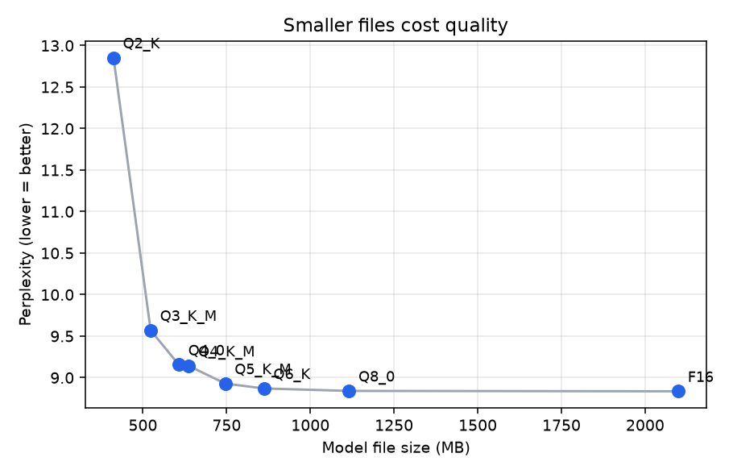
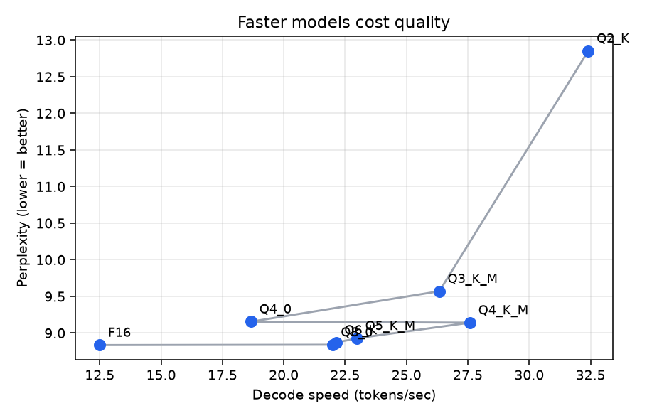
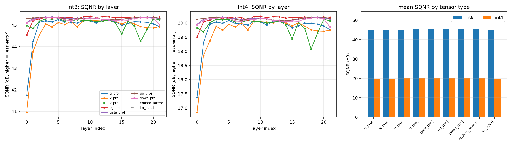

# Quantization results: TinyLlama 1.1B

**Hardware:** AMD Ryzen 5 7520U with Radeon Graphics | 4 cores / 8 threads | 7.2 GB RAM | Windows 11
**Settings:** 4 threads, 3 runs per prompt, 128 max new tokens, greedy decoding

**Headline:** Q4_K_M: 70% smaller than F16, 2.2x faster decoding, +3.5% perplexity

**Recommendation:** Q4_0 is the smallest level within 5% of F16 perplexity (Q4_0: 71% smaller than F16, 1.5x faster decoding, +3.6% perplexity). The 5% budget is an arbitrary choice; see the budget table below.

## Size, speed and quality

| Level | Size MB | % of F16 | Peak RAM MB | Decode tok/s (±std) | Prompt tok/s | Speedup | Perplexity | vs F16 |
|---|---|---|---|---|---|---|---|---|
| F16 | 2099 | 100% | 2066 | 12.5 ± 0.7 | 43 | 1.00x | 8.836 ± 0.227 | +0.0% |
| Q8_0 | 1116 | 53% | 1179 | 22.0 ± 1.4 | 59 | 1.76x | 8.840 ± 0.227 | +0.1% |
| Q6_K | 862 | 41% | 940 | 22.1 ± 3.8 | 88 | 1.77x | 8.870 ± 0.228 | +0.4% |
| Q5_K_M | 746 | 36% | 833 | 23.0 ± 1.2 | 84 | 1.84x | 8.929 ± 0.230 | +1.1% |
| Q4_K_M | 637 | 30% | 1187 | 27.6 ± 1.2 | 97 | 2.21x | 9.142 ± 0.232 | +3.5% |
| Q4_0 | 607 | 29% | 1195 | 18.7 ± 1.9 | 73 | 1.49x | 9.155 ± 0.233 | +3.6% |
| Q3_K_M | 523 | 25% | 811 | 26.3 ± 2.6 | 91 | 2.11x | 9.571 ± 0.242 | +8.3% |
| Q2_K | 412 | 20% | 528 | 32.4 ± 1.3 | 86 | 2.59x | 12.853 ± 0.332 | +45.5% |

## Same prompt, every level

| Level | Answer to: "Explain what a neural network is in simple terms." (first 220 chars) |
|---|---|
| F16 | A neural network is a type of artificial intelligence (AI) system that mimics the way the human brain works. It consists of a series of interconnected nodes (neurons) that receive input data (inputs) and generate output  |
| Q8_0 | A neural network is a type of artificial intelligence (AI) system that mimics the way the human brain works. It consists of a series of interconnected nodes (neurons) that process information and make decisions based on  |
| Q6_K | A neural network is a type of artificial intelligence (AI) system that mimics the way the human brain works. It consists of a series of interconnected nodes (neurons) that receive input data (input nodes) and generate ou |
| Q5_K_M | A neural network is a type of artificial intelligence (AI) model that mimics the way the human brain works. It consists of a series of interconnected nodes (neurons) that receive input data (inputs) and generate output d |
| Q4_K_M | A neural network is a type of artificial intelligence (AI) model that mimics the way the human brain processes information. It consists of a series of interconnected layers of neurons, each of which is responsible for pr |
| Q3_K_M | A neural network is a mathematical model that simulates the behavior of the human brain. It consists of a series of layers of neurons, each with its own set of connections to other neurons. The layers are connected in a  |
| Q2_K | A neural network is a mathematical model that maps a set of input data (or "input vector") to a set of output data (or "output vector") to represent a complex or non-linear function. It is a type of artificial intelligen |
| Q4_0 | A neural network is a type of artificial neural system that is designed to mimic the way the human brain processes information. It consists of a series of interconnected nodes (neurons) that are connected by synapses. Ea |

## Recommendation vs. quality budget

The budget is a judgement call, not a standard. The pick changes with it:

| Max perplexity increase | Picked level | Size MB | vs F16 |
|---|---|---|---|
| 2% | Q5_K_M | 746 | +1.1% |
| 5% | Q4_0 | 607 | +3.6% |
| 10% | Q3_K_M | 523 | +8.3% |

## Thread scaling (Q4_K_M)

| Threads | Decode tok/s |
|---|---|
| 1 | 13.1 |
| 2 | 22.5 |
| 4 | 26.0 |

## API load test

| Concurrent clients | Req/s | Tokens/s | p50 latency s | p95 latency s |
|---|---|---|---|---|
| 1 | 0.87 | 27.8 | 1.06 | 1.77 |
| 2 | 0.92 | 29.5 | 2.07 | 2.40 |
| 4 | 0.95 | 30.5 | 4.14 | 4.23 |
| 8 | 0.83 | 26.5 | 5.38 | 9.63 |

## My quantizer vs llama.cpp (Q8_0 / Q4_0)

Each tool is compared with **its own** F16 baseline. Absolute perplexities differ between the two tools (different tokenizer and eval code), so only the deltas are comparable.

| Tool | Level | Bits/weight (incl. scales) | Perplexity (own evaluator) | Δ vs own F16 | ± paired SE |
|---|---|---|---|---|---|
| mine (HF transformers) | fp16 | 16 | 8.836 | - | - |
| mine (HF transformers) | int8 | 8.5 | 8.839 | +0.03% | 0.03% |
| mine (HF transformers) | int4 | 4.5 | 9.359 | +5.92% | 0.42% |
| mine (HF transformers) | int4_head8 | ~4.5 (lm_head 8.5) | 9.291 | +5.15% | 0.41% |
| llama.cpp | F16 | 16 | 8.836 | - | n/a (stored ± is unpaired) |
| llama.cpp | Q8_0 | 8.5 | 8.840 | +0.05% | n/a (stored ± is unpaired) |
| llama.cpp | Q4_0 | 4.5 (output.weight Q6_K) | 9.155 | +3.62% | n/a (stored ± is unpaired) |

Weight error on identical tensors (reference = the F16 GGUF):

| Format | Tensors compared | llama.cpp SQNR (dB) | mine SQNR (dB) |
|---|---|---|---|
| Q8_0 vs my int8 | 156 | 45.17 | 45.18 |
| Q4_0 vs my int4 | 155 | 21.13 | 20.06 |

## How to read this / caveats

- **Perplexity** = how surprised the model is by WikiText-2 text (lower = better). It is a proxy for quality, not a task score.
- **Peak RAM** = highest resident memory of the process. llama.cpp memory-maps the model file, so this includes the model's pages, plus a roughly constant overhead for Python, libraries and the 1024-token KV cache. Compare levels by the differences, not the absolute floor.
- **Repacking effect:** on CPUs with AVX2, llama.cpp repacks `Q4_K` tensors into an interleaved layout (`q4_K_8x8`) with faster kernels, at the cost of an extra in-memory copy. Verified with `verbose=True` loading: Q4_K_M +455 MiB, Q3_K_M +185 MiB, Q2_K +6 MiB, all other levels none. That is why Q4_K_M's RAM is higher than Q5_K_M/Q6_K and why its speed is relatively high.
- **Decode tok/s** excludes prompt processing; **Prompt tok/s** is measured on a ~100+ token prompt.
- Each level ran in a fresh process; std is across repeated runs. Numbers are specific to this CPU.
